# Mailflare for iOS

The native iPhone app lives in `ios/`. Its design is in
[superpowers/specs/2026-11-28-ios-app-design.md](superpowers/specs/2026-11-28-ios-app-design.md).
This page describes what exists after all five stages (reading, acting on mail, writing,
notifications, search) and how to set it up.

## What the app does today

- Signs in through Cloudflare Access with a service token of its own and then with a
  Mailflare account, including the second factor.
- Keeps the mail of the last 30 days on the phone, with content, and the smaller
  attachments. Lists and messages open without a network.
- Shows mailboxes, the folders, the five inbox categories, conversations and messages.
- Opens calendar, Drive, the account's settings and administration as web pages inside
  the app.
- Follows changes while it is on screen, and asks iOS to wake it now and then.

- Opening a message marks it read. Mail can be archived, deleted, starred, snoozed, moved,
  marked as spam and deleted for good, by swiping a row, from the long-press menu, for several
  rows at once, and from the reader. Every change shows at once and is sent by the next sync,
  also when it was made without a network. A change the server refuses is put back and said.

- Mail can be written, answered (to the sender or to all) and forwarded: recipients with
  suggestions from the address book, bold, italic, underline, lists and links, attachments
  from Files and Photos, the sender chosen from the mailboxes that may send. A message is
  kept on the phone the moment **Send** is tapped and goes out with the next sync, so it
  can be written without a network. It waits under **Outbox**, where a message put aside
  as a draft also stays. Sending is safe to repeat: the server keeps one draft per message
  and a message that already went is not sent again. A message the server refuses, or
  fails on five times, is marked there with the reason and can be opened and sent again.

- Search, from the field of every list: the mail on the phone is searched as it is typed,
  in subject, sender, recipients and content, also without a network. A word's beginning is
  enough and accents do not matter. After a short pause the server is asked too and adds
  what the phone does not hold, such as mail older than the offline period; such a message
  opens from the server. Spam is left out, as on the web.

- Notifications from Apple for new mail, once the server holds an Apple key (see
  *Notifications* below): sender, subject and the first lines, grouped by conversation,
  with the number of unread inbox mail at the icon. Archive, mark as read and delete work
  from the notification, for every signed-in account, once the phone is unlocked. Tapping opens the message, in its
  account. The notification also wakes the app so the mail is on the phone by then.

Notifications still lack answering from the notification and the silent update of the
number at the icon when mail is read on another device; the number is corrected by every
sync instead. Writing still
lacks the web's warnings before sending (lookalike address, many visible recipients,
missing attachment), undo send, scanning a document with the camera, and drafts that
show on other devices: a draft put aside in the app stays on this phone.

## Before the first start: Cloudflare Access

Mailflare usually sits behind Cloudflare Access. The app cannot use the interactive
sign-in, so each device gets a service token.

1. In Cloudflare Zero Trust open **Access → Service Auth → Service Tokens** and create one
   token per device, named after it. Copy the Client ID and the Client Secret; the secret
   is shown once.
2. Open the Access application that protects Mailflare and add a policy with the action
   **Service Auth** that includes these tokens. Keep the existing policies.
3. If the installation uses Turnstile on its sign-in page, the Worker needs
   `MCP_ACCESS_ISSUER` and `MCP_ACCESS_AUDIENCE` (they are already set where ChatGPT is
   connected). The app's sign-in skips Turnstile and instead requires a signed Access
   assertion. When the app is protected by a different Access application than MCP, set
   `APP_ACCESS_AUDIENCE` to that application's audience tag.

A lost phone is cut off by revoking its token in Cloudflare, or by signing it out under
**Settings → Signed-in devices** in the app on another device. Either one is enough to stop
it. Changing the account's password signs every device and browser out. The web interface
does not list devices yet; that comes with the native settings.

## Server changes the app needs

Apply these migrations before the code that uses them is deployed:

- `0085_mail_changes.sql`: the change log `mail_changes` and its triggers. Every insert,
  delete and list-relevant update of a message adds a row; a nightly job drops rows older
  than 45 days.
- `0086_device_sessions.sql`: `device_sessions`, the device behind an app's session.
- `0087_app_devices.sql`: `app_devices`, the address Apple gave the app of a session.
  Only read when the Apple key is set.

New routes, all behind the usual session check:

| Route | Purpose |
| --- | --- |
| `POST /api/app/login`, `POST /api/app/login/mfa` | Sign-in for the app. Returns a device session token (`dev_…`), sets no cookie. |
| `GET /api/app/sync?cursor=&days=&limit=` | First the last `days` in pages, then only what changed since the cursor. |
| `GET /api/app/devices`, `DELETE /api/app/devices/[id]` | The devices signed in to the account, and signing one of them out. |
| `POST /api/app/push`, `DELETE /api/app/push` | The app hands over, or takes back, the address Apple reaches it at. Only a device session may. |

A device session lasts 90 days and renews itself while it is used. The app sends it in the
header `X-Mailflare-Session`, on `/api/realtime` too. It must not use `Authorization: Bearer`:
an Access application with Managed OAuth (as set up for ChatGPT) claims that header for its
own access tokens and answers 401 to anything else before the request reaches Mailflare.
The first TestFlight build did exactly that: sign-in worked, every later request was refused.

## Notifications

New mail is announced through Apple's push service from the same place that sends web push
(`sendPushNotifications`), with the same checks: a session that still holds, an active
user, the right to read the mailbox now, mail that is worth a notification
(`src/lib/push/apns.ts`). A Worker reaches `api.push.apple.com` directly; that was tried
from Cloudflare's network before this was built.

The server needs a key from the Apple developer account, created once:

1. At developer.apple.com open **Certificates, Identifiers & Profiles → Keys → +**, name
   the key, tick **Apple Push Notifications service (APNs)** and download the `.p8` file.
   It can be downloaded once. Note the **Key ID** shown there.
2. Apply migration `0087_app_devices.sql`.
3. Set on the Worker: the secret `APNS_KEY` (the whole text of the `.p8` file), and
   `APNS_KEY_ID`, `APNS_TEAM_ID` (`4F3M4YYQN3`) and `APNS_BUNDLE_ID`
   (`de.steffenvonlindern.mailflare`).

Without these four the server sends nothing to Apple and does not read the table. The app
asks for permission after the first sign-in and registers at every start; a TestFlight
build is known to Apple's production service, a development build to the sandbox. An
address Apple reports as gone is forgotten.

## First start

1. **Server address**: the address Mailflare is opened at in the browser.
2. **Access key**: Client ID and Client Secret of this device's service token. They can be
   typed, pasted, or scanned as a QR code that contains
   `mailflare-access:<client id>:<client secret>`.
3. **Sign in** with the Mailflare account, then the second factor if it is switched on.

The first sync fetches the last 30 days in pages; the list is usable after the first page.

## What is stored on the phone

| What | Where | Protection |
| --- | --- | --- |
| Access key and session tokens | Keychain | This device only, readable after the first unlock |
| Mail, one database per account | App's Application Support folder | Encrypted by iOS until the first unlock |
| Attachments up to 5 MB from the offline period | Next to the database | Same |

Signing an account out removes its mail from the phone. So does a session the server has
ended. The offline period (7 to 90 days) and the attachment rule are set in the app under
**Settings**.

## Building and testing

Xcode's command line tools are reached through `DEVELOPER_DIR`; `xcode-select` need not be
changed.

```sh
export DEVELOPER_DIR=/Applications/Xcode.app/Contents/Developer
(cd ios/MailflareKit && swift test)
xcodebuild -project ios/Mailflare.xcodeproj -scheme Mailflare \
  -destination 'platform=iOS Simulator,name=iPhone 17' -derivedDataPath ios/DerivedData test
```

- `ios/Mailflare.xcodeproj` is generated: after adding or removing files run
  `xcodegen generate --spec ios/project.yml` and commit the result.
- German texts live in one table, `ios/tools/strings.py`. Run it after changing a text;
  `python3 ios/tools/strings.py --check ios/DerivedData` lists texts without a translation.
- The JSON the Swift tests decode comes from the real routes:
  `node ios/MailflareKit/Tests/MailflareKitTests/Fixtures/generate.mjs`.
- `node ios/tools/local-server.mjs` runs the built Worker over a local database with
  made-up mail for the simulator (`npm run build` first).
- With that server running, the walk-through drives the app through setup, the lists, the
  reader and a start without a connection, and keeps a screenshot of every step:

  ```sh
  TEST_RUNNER_MAILFLARE_UI_SERVER=http://127.0.0.1:8799 xcodebuild test \
    -project ios/Mailflare.xcodeproj -scheme MailflareUI \
    -destination 'platform=iOS Simulator,name=iPhone 17' -derivedDataPath ios/DerivedData \
    -resultBundlePath ios/DerivedData/walkthrough.xcresult
  ```

The app accepts `https` addresses only. A development build also accepts `http` for
`localhost` and `127.0.0.1`, which is how the simulator reaches the local server.

## Getting it onto a phone: TestFlight through Xcode Cloud

The project is ready for it: bundle identifier `de.steffenvonlindern.mailflare`, team
`4F3M4YYQN3`, automatic signing, a 1024 px icon without transparency (drawn by
`ios/tools/make-icon.swift`), a privacy manifest, and the export-compliance answer in the
Info.plist. An unsigned release archive builds with package resolution switched off, which
is how Xcode Cloud builds. What is left needs the Apple account and is done once:

1. **App record.** In App Store Connect choose **Apps → + → New App**: platform iOS, bundle
   ID `de.steffenvonlindern.mailflare` (register it under *Certificates, Identifiers &
   Profiles* first if it is not offered), SKU `mailflare-ios`. The name must be free in the
   whole App Store, also for an app that only ever lives in TestFlight; if "Mailflare" is
   taken, any other name works, the name under the icon stays "Mailflare".
2. **Workflow.** Open `ios/Mailflare.xcodeproj` in Xcode, then **Integrate → Create
   Workflow**. Pick the app `Mailflare`, let Xcode Cloud connect to the GitHub repository,
   and set:
   - Start condition: branch changes to `main`, limited to files under `ios/`.
   - Action: **Archive**, scheme `Mailflare`, platform iOS.
   - Post-action: **TestFlight Internal Testing**, with a group that holds the testers.
3. **Testers.** Internal testers are people of the App Store Connect team (**Users and
   Access**); add them to the group. They install the TestFlight app and accept the invite.

Xcode Cloud numbers the builds itself. A TestFlight build runs for 90 days; every later
build renews that. Nothing needs to be built in a script before the archive, so there is
no `ci_scripts` folder.

To try a build before the pull request is merged, start the workflow by hand for the
branch `feature/ios-app` (**Start Build** in Xcode's Report navigator or in App Store
Connect).

## What it looks like

Taken by the walk-through in the simulator, with made-up mail:

| Inbox | Message | Newsletter | Mailboxes |
| --- | --- | --- | --- |
| 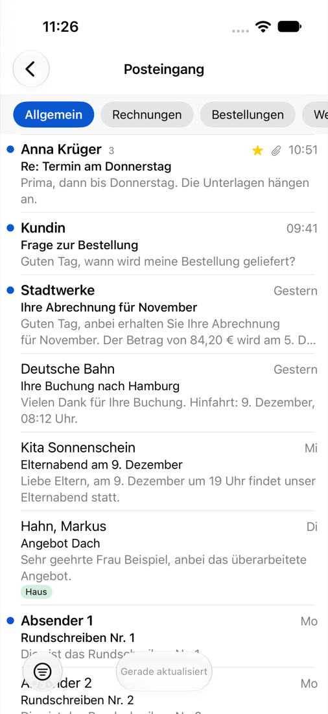 | 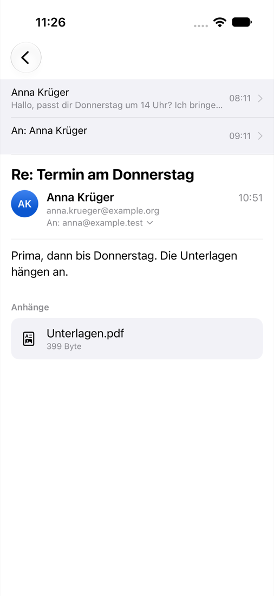 | 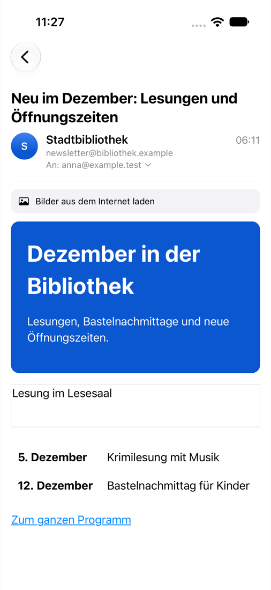 | 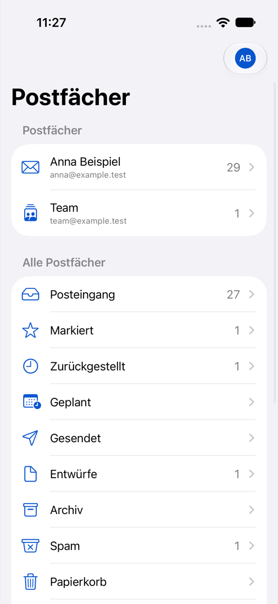 |

| Without a connection | Devices | Dark | Dark newsletter |
| --- | --- | --- | --- |
| 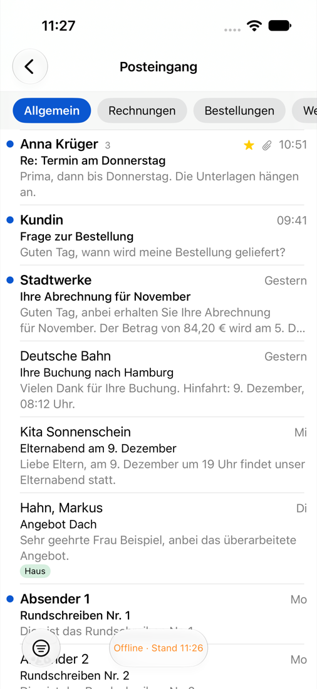 | 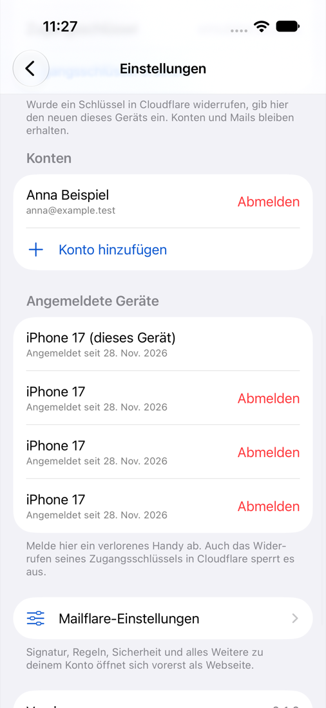 | 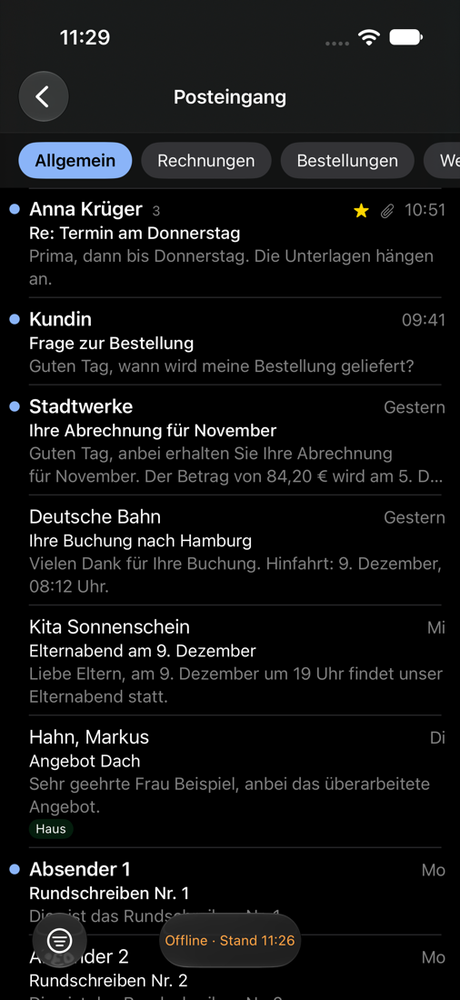 | 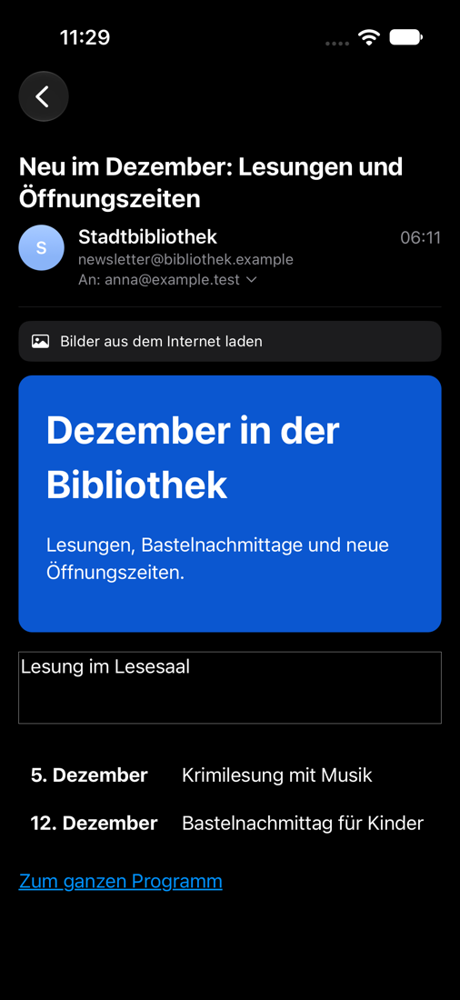 |

| Swipe from the leading edge | Swipe from the trailing edge | Selecting several |
| --- | --- | --- |
| 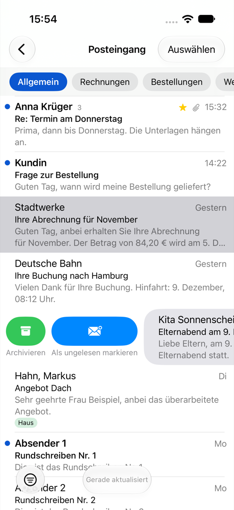 | 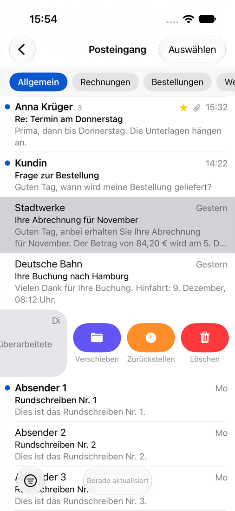 | 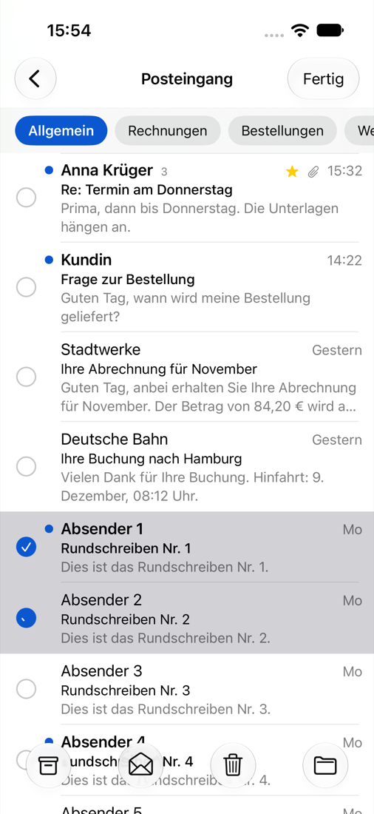 |

| Writing | Answering | Outbox |
| --- | --- | --- |
| 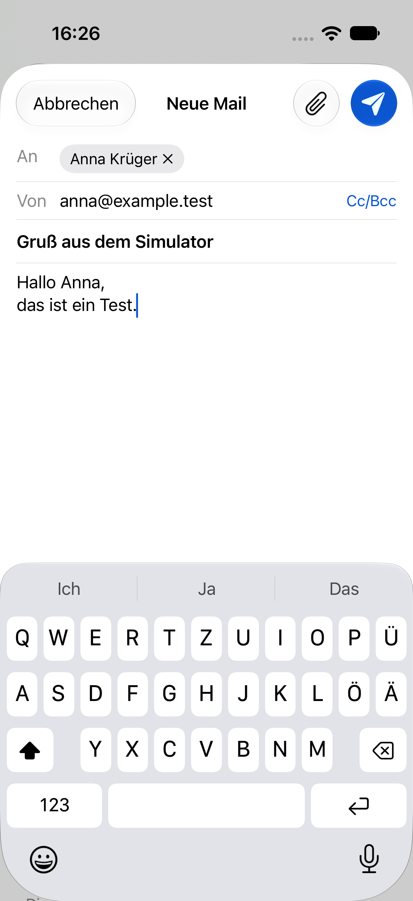 | 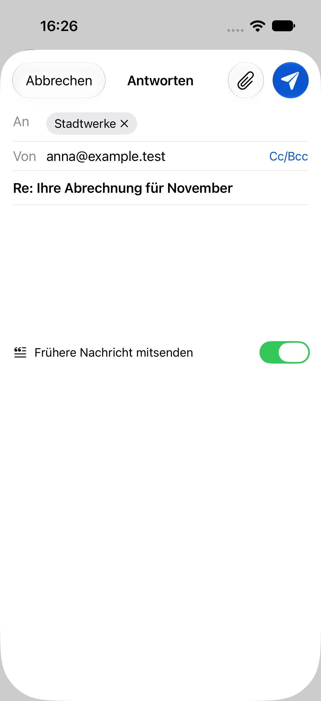 | 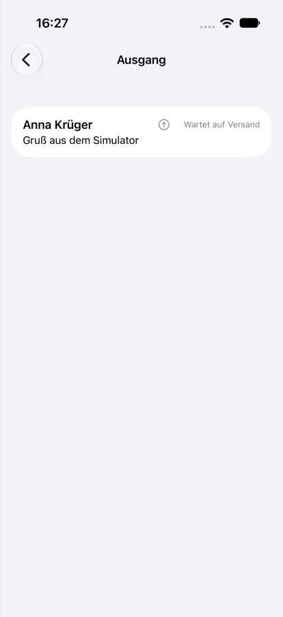 |

| Search on the device | Older mail from the server |
| --- | --- |
| 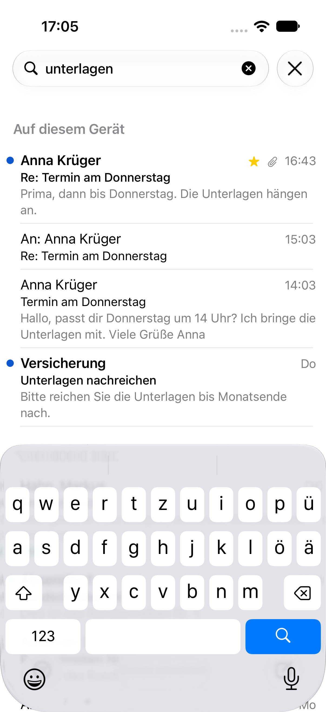 | 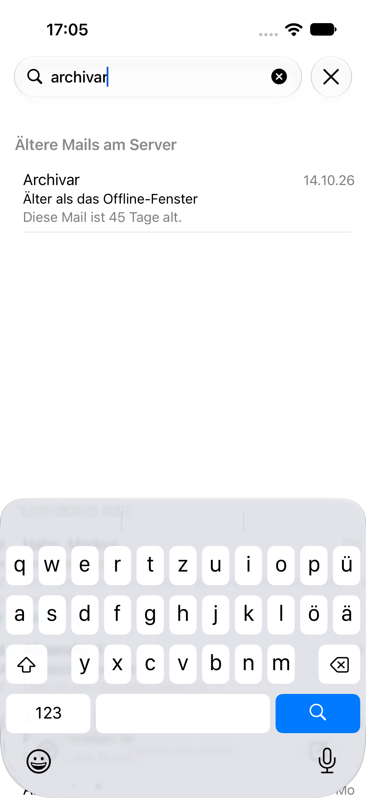 |

## What only a real iPhone can show

The simulator and the tests cannot prove these, and none of them has been tried on a device:

- Cloudflare Access with a real service token, for API calls, the realtime connection and
  above all the in-app web pages. Those rely on the cookie Access returns for a
  service-token request reaching every request of the page.
- Haptics.
- Background refresh, which iOS grants as it sees fit.
- Fetching attachments only on Wi-Fi.
- The camera for the QR code.
- Notifications. The tests prove what the server sends to Apple and what the app does with
  a notification; the delivery itself needs the Apple key and a phone.
- Sending a message for real. The local test server has no way to deliver mail, so the
  tests prove the requests and their order, not a delivery.
